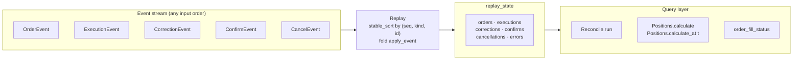

# TradeTrace

On a trading desk, reconciliation is the daily discipline of matching your internal fill records against what your broker says actually happened. When a price gets entered wrong, a confirmation arrives for a trade you have no record of, or a correction comes in hours after the original fill, the reconciliation engine has to surface every discrepancy cleanly — without corrupting the position blotter in the process.

This project models that operations pipeline in OCaml: deterministic event replay over an immutable log, partial fill tracking with overfill prevention, correction chains with full audit history, and bitemporal position queries that let you ask what the system knew at any past point in time.

It is a learning exercise and portfolio project, not production software.

---

## Architecture



### Modules

| Module | Responsibility |
|--------|---------------|
| `Types` | Domain types: `order`, `execution`, `broker_confirm`, `cancellation`, `correction`, `event` variant. Fixed-point prices (`price = int`, 1 unit = 1 cent). Deterministic `compare_events` with compound key `(seq, kind_rank, event_id)`. |
| `Replay` | Sorts events by `seq`, then folds `apply_event` over the sorted list. Validates qty/price sign, limit prices, symbol/side consistency, and overfills at both execution and correction time. All failures are non-fatal and go to `state.errors`. |
| `Reconcile` | Compares post-correction executions against broker confirms. Returns one of eight status codes per execution. Checks symbol and side before price and quantity, because a wrong symbol is likely a routing error — a different problem than a price discrepancy. |
| `Positions` | Derives net positions and cash balance from resolved executions. `calculate` returns the full current state; `calculate_at trade_cutoff` filters by exchange timestamp. |

---

## Three timestamps

Every event carries three independent time fields:

| Field | Meaning | Used for |
|-------|---------|----------|
| `trade_time` | When the exchange executed the trade | Filtering by settlement date in position queries |
| `arrival_time` | When the system received the message | Latency monitoring; recorded but not used for ordering |
| `seq` | Monotonic message-bus counter | The **only** key used for replay ordering |

Keeping these separate is what makes bitemporal queries meaningful. `seq` determines what the system knew; `trade_time` determines what had already happened.

---

## Bitemporal queries

The replay engine exposes two composable functions:

```ocaml
(* What did the system know at sequence S? *)
Replay.replay_until s events

(* Of that state, which trades had already settled before time T? *)
|> Positions.calculate_at t
```

This answers **"what did we know then?"** — the trader's view of positions at sequence point `s`, filtered to trades with exchange timestamps before `t`.

For the corrected historical view — **"what do we know now about then?"** — use the full replay:

```ocaml
Replay.replay events
|> Positions.calculate_at t
```

This applies every correction that ever arrived, regardless of sequence, then filters by trade time. The result may differ from what the trader saw in real time, because corrections that came later are now included.

The difference matters for P&L restatements and audit: the first query reconstructs what a human saw on screen; the second reconstructs what was actually true.

---

## Validation

All rule violations are non-fatal. They land in `replay_state.errors` and replay continues — the desk needs the full set of problems in a batch, not just the first one.

| Event | Checks enforced |
|-------|----------------|
| `OrderEvent` | Duplicate ID · non-positive qty · non-positive limit price |
| `ExecutionEvent` | Duplicate ID · non-positive qty/price · unknown order · cancelled order · symbol mismatch · side mismatch · limit price violation · overfill |
| `CorrectionEvent` | Duplicate ID · non-positive qty/price · unknown execution · corrected price violates order limit · would overfill |
| `ConfirmEvent` | Duplicate · non-positive qty/price |
| `CancelEvent` | Unknown order |

A correction to `corrected_qty = 0` is rejected. A correction says "the fill happened but the data was wrong." Zeroing a fill is a different business event — a bust or reversal — and conflating them makes audit trails ambiguous.

---

## Demo output

The binary runs five scenarios through a single event stream:

| Order | Symbol | Outcome |
|-------|--------|---------|
| ORD-001 | AAPL Buy 100 | Fully filled · broker confirms correctly → `MATCHED` |
| ORD-002 | MSFT Buy 50 | Filled · broker reports $421.00, we recorded $419.50 → `PRICE_MISMATCH` |
| ORD-003 | GOOG Sell 10 | Filled internally · no broker confirmation received → `UNCONFIRMED` |
| ORD-004 | AMZN Buy 100 | 25 shares filled · price correction at seq=20 · broker confirms corrected price → `MATCHED` |
| *(none)* | TSLA Sell 5 | Broker sends a confirm · no internal execution exists → `UNEXPECTED` |

```
$ dune exec tradetrace

=== Replay errors (0) ===

=== Reconciliation ===
  EX-001    MATCHED
  EX-002    PRICE_MISMATCH (internal=$419.50  broker=$421.00)
  EX-003    UNCONFIRMED
  EX-004    MATCHED
  EX-999    UNEXPECTED

=== Current positions (full replay) ===
  AAPL    +100
  AMZN    +25
  GOOG    -10
  MSFT    +50
  Cash    -$26190.00

=== Mismatch spotlight: EX-002 (MSFT) ===
  Internal record : EX-002  qty=50  price=$419.50
  Broker confirm  : BRK-002  qty=50  price=$421.00
  Difference      : $1.50

=== Order fill status ===
  ORD-001   filled=100/100  open=0  execs=[EX-001]
  ORD-002   filled=50/50  open=0  execs=[EX-002]
  ORD-003   filled=10/10  open=0  execs=[EX-003]
  ORD-004   filled=25/100  open=75  execs=[EX-004]

=== Bitemporal positions ===

  [seq ≤ 15, all trade_times] — EX-004 at original price $189.60:
  AAPL    +100
  AMZN    +25
  GOOG    -10
  MSFT    +50
  Cash    -$26200.00

  [all seqs, all trade_times] — EX-004 at corrected price $189.20:
  AAPL    +100
  AMZN    +25
  GOOG    -10
  MSFT    +50
  Cash    -$26190.00

  [all seqs, trade_time ≤ 1003] — only AAPL and MSFT:
  AAPL    +100
  MSFT    +50
  Cash    -$38960.00

  [seq ≤ 15, trade_time ≤ 1006] — AMZN cash before correction:
    Portfolio cash: -$26200.00

  [all seqs, trade_time ≤ 1006] — AMZN cash with hindsight correction:
    Portfolio cash: -$26190.00
```

The last two lines show the same portfolio filtered to `trade_time ≤ 1006`. Before the correction (seq ≤ 15), the AMZN fill is priced at $189.60; in the full replay, it is corrected to $189.20. The $10 difference is 25 shares × $0.40.

---

## Build and test

Requires OCaml 4.14+ and Dune 3.0+.

```bash
eval $(opam env)

dune build                                      # compile everything
dune exec tradetrace                            # run the demo
dune runtest                                    # 96 automated tests
./_build/default/test/test_tradetrace.exe       # run test binary directly
```

A GitHub Actions CI workflow is included at `.github/workflows/ci.yml`. It builds and runs `dune runtest` on Ubuntu using OCaml 4.14.5. No CI badge is shown here until the workflow has actually run on GitHub.

---

## Engineering decisions

**Fixed-point prices.** `price = int` in cents. No `float` anywhere. Floating-point rounding accumulates across a large book and shows up as phantom P&L at end of day, especially on block trades. Fixed-point sidesteps that; callers pay the cost of formatting via `pp_price`.

**Immutable state, pure functions.** `apply_event` takes a state and returns a new one; nothing is mutated. This makes replay trivially restartable, bitemporal snapshots free of aliasing bugs, and the test surface extremely simple — the same input always produces the same output.

**Deterministic replay via compound sort key.** Events are `List.stable_sort`-ed by `(seq, event_kind_rank, event_id)` before folding. The kind rank — `Order=0 → Execution=1 → Correction=2 → Confirm=3 → Cancel=4` — mirrors the dependency chain, so if two events share a seq value (which a well-formed stream avoids, but we handle gracefully), the order is always processed before the execution that references it. `replay (perm₁ events) = replay (perm₂ events)` for any two permutations of the same event log.

**Corrections as a most-recent-first list.** `replay_state.corrections` maps each `exec_id` to a `correction list` stored in descending seq order. `List.hd` gives the currently effective correction in O(1); the full chain is preserved for audit. A rejected correction does not consume its ID, so a corrected resubmission with the same correction ID is accepted.

**Overfill checked at correction time.** A correction replaces the current resolved quantity of its target execution and re-tests the cumulative fill against the order limit. A correction that reduces a prior fill opens capacity for a subsequent execution; one that inflates past the order boundary is rejected regardless of correction chain depth.

**Non-fatal validation errors.** Every rule violation goes to `state.errors`; replay continues. Operations teams need the full picture from a batch, not an early exit on the first problem.

---

## Limitations

| Limitation | Notes |
|------------|-------|
| No persistence | State lives in memory for one `replay` call. No serialisation, database, or on-disk log. |
| No streaming replay | `replay` and `replay_until` require the full event list in memory. A streaming model would need incremental state management. |
| Duplicate seq numbers not flagged | Two events with the same seq are sorted deterministically (by kind rank, then event ID) but no error is recorded. The invariant that seq values are unique is not enforced. |
| Corrections do not amend `trade_time` | A correction changes `qty` and `price` but not the exchange timestamp. Corrections that imply a different settlement date are not modelled. |
| Cancellations do not reverse fills | Cancelling an order prevents new fills but does not reverse executions accepted before the cancellation. |
| Single-symbol, single-side orders only | Pairs trades, spreads, and allocations are out of scope. |
